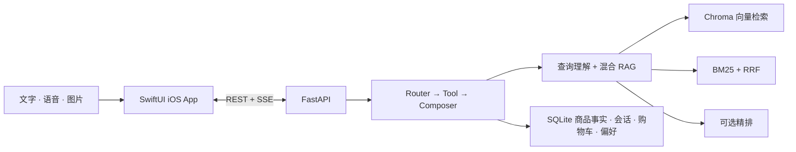

# CartPilot — 多模态电商智能导购 AI Agent

[English](README.md) | [简体中文](README.zh-CN.md)

<p align="center">
  
  <a href="client/README.zh-CN.md"></a>
  <a href="#1-环境要求"></a>
  <a href="https://github.com/YufanPeter/E-commerce-AI-Agent/stargazers"></a>
  <a href="https://github.com/YufanPeter/E-commerce-AI-Agent/issues"></a>
  
  <a href="LICENSE"></a>
</p>

<p align="center">
  
</p>

<h3 align="center">
  🏆 字节跳动优秀项目奖
</h3>

CartPilot 是一个**女性补给平台**：围绕女性运动与营养研究中反复出现的话题——铁和能量摄入、骨骼健康、经期周期、运动内衣支撑——提供运动营养、女性营养素、经期关怀、运动服饰、运动修护和功能轻食。用户用文字、语音或图片说出需求，AI 会结合她的身体档案、成分禁忌和所处的周期阶段来推荐，并在同一段对话中完成对比、详情查询、加购和下单。

项目采用原生 SwiftUI 客户端、FastAPI 后端、可控的 `router → tool → composer` Agent、混合 RAG 检索与 SQLite 商品事实库。

## Demo

<p align="center">
  <a href="assets/demo_pic.png"></a>
</p>

<p align="center"><sub>CartPilot iOS App — 通过文字、语音或商品图片开启导购对话。</sub></p>

## 核心能力

- **多模态输入：** 支持文字、中文语音识别、相机拍摄和相册选图。
- **对话式导购：** 支持推荐、细化、澄清、对比、商品详情和购物车操作。
- **上下文与记忆：** 能理解“第二个”等指代，保存会话上下文，并记录可撤销的用户偏好。
- **混合检索：** 结构化过滤 + Chroma 向量召回 + BM25/RRF + 可选精排。
- **成分安全筛选：** 孕期/备孕/哺乳、敏感肌、不碰咖啡因、纯素和过敏原（乳制品、大豆、坚果、麸质、鱼）按商品的结构化属性硬过滤，“不要含咖啡因”这类说法也走同一套规则（`backend/search/safety.py`）。
- **身体档案与周期关怀：** 肤质、肤色冷暖和尺码用于自动预选尺码/色号；网页版可在本机记录经期周期，首页按经期、卵泡期、排卵期前后、黄体期给出补给建议，周期数据不上传。
- **事实一致性：** 价格、SKU、库存和购物车总价来自 SQLite，不由大模型生成。

仓库内置 48 个商品、166 个 SKU，覆盖运动营养、女性营养素、经期关怀、运动服饰、运动修护、功能轻食六大类目。品牌均为虚构示例，商品数据由 `scripts/women_catalog_spec.py` 生成（`python3 scripts/generate_women_catalog.py`），描述只介绍用途与适合人群，不做疗效承诺。

## 系统架构



大模型负责理解意图和组织回答；检索、对比和购物车操作由确定性工具执行，SQLite 始终是商品事实的权威来源。

## 快速开始

```bash
git clone https://github.com/YufanPeter/E-commerce-AI-Agent.git
cd E-commerce-AI-Agent
```

### 1. 环境要求

- macOS、Xcode 15+、iOS 17+ 模拟器
- Python 3.10+，推荐 Python 3.11 或 3.12
- 下表所需能力对应的兼容模型 API 凭证

### 2. 配置 API Key

项目使用三类模型能力，但不限定具体模型名称：

| 能力 | 使用位置 | 接口要求 |
| --- | --- | --- |
| 通用多模态大模型 | 意图路由、查询理解、回答生成、图片转检索词 | 兼容 OpenAI Chat API，支持 function calling 和图片输入 |
| Embedding 模型 | 离线构建 Chroma 索引、在线查询向量化、图片相似度计算 | 文本与图片位于同一向量空间，并兼容当前多模态 embedding 适配器 |
| Reranking 模型（可选） | 在商品聚合前对召回的证据 chunk 重新排序 | 返回格式兼容当前 reranker 适配器 |

`ARK_*` 和 `ZHIPU_*` 只是为兼容当前代码而保留的变量名，并不限定模型厂商；变量值可以指向你选择的兼容 API。

在仓库根目录创建 `.env`：

```dotenv
# 通用多模态大模型 API
ARK_API_KEY=你的模型_API_Key
ARK_MODEL=你的通用模型_ID
ARK_BASE_URL=https://your-model-api.example.com/v1

# Embedding API；未设置独立 Key 时会回退复用 ARK_API_KEY
ARK_EMBEDDING_API_KEY=你的_embedding_API_Key
ARK_EMBEDDING_MODEL=你的_embedding_模型_ID
ARK_EMBEDDING_BASE_URL=https://your-embedding-api.example.com/v1

# 可选：Reranking API
ZHIPU_API_KEY=你的_reranking_API_Key
RERANK_MODEL=你的_reranking_模型_ID
RERANK_BASE_URL=https://your-rerank-api.example.com/rerank

USE_HYBRID=1
USE_RERANK=1
```

如果不使用 Reranking 模型，删除对应的三个变量，并设置 `USE_RERANK=0`。

### 3. 安装依赖并初始化数据

全新 clone 后需要生成一次本地 SQLite 数据库与 Chroma 元数据：

```bash
python3 -m venv .venv
source .venv/bin/activate
python -m pip install -r backend/requirements.txt

cd backend
python -m store.import_product_data --reset
python -m store.import_image_manifest
python -m rag.build_chroma --reset
cd ..
```

`rag.build_chroma` 会调用 `.env` 中配置的 embedding 接入点。

> 商品目录换成女性补给后，`backend/storage/image_index.json`（拍照找同款用的图片向量）被清空了。内置商品图是 SVG 占位图，换成真实商品照片后，把图片地址写进 `backend/cdn/image_manifest.json`，再运行 `python -m rag.build_image_index` 重建，拍照搜索才会按图片相似度精排。

### 4. 启动后端

```bash
./scripts/start_backend.sh
```

检查服务是否正常：

```bash
curl http://127.0.0.1:8000/health
```

预期返回：

```json
{"status":"ok"}
```

开发时需要 Python 自动重载，可以使用 `./scripts/dev.sh`。

### 5. 运行 iOS App

```bash
open client/AIShoppingGuide.xcodeproj
```

在 Xcode 中打开 **Product → Scheme → Edit Scheme → Run → Arguments**，将 `BACKEND_BASE_URL` 设置为 `http://127.0.0.1:8000`；也可以取消勾选该变量，让模拟器使用默认 localhost。

选择一个 iPhone 模拟器，点击 **Run**，然后尝试：

```text
经期也想照常训练，推荐 200 元以内、不含咖啡因的补给
```

### 6. 运行网页版

网页版在 `web/` 目录（React + Vite + TypeScript + Tailwind），需要 Node.js 20+。

```bash
cd web
npm install
```

**只看前端（模拟数据，不需要后端和模型 Key）：**

```bash
npm run dev:mock
```

打开 `http://localhost:5173`。模拟层直接读取 `data/` 下的商品 JSON 和图片，用脚本化的 SSE 流回答对话，购物车和偏好存在浏览器本地；接口路径、SSE 事件名和字段与真实后端一致。

**连接本地后端：**

先按第 4 步启动后端（`http://127.0.0.1:8000`），再运行

```bash
npm run dev
```

开发服务器把 `/api/*` 代理到 `http://127.0.0.1:8000`，所以不需要给后端加 CORS。两种模式只差环境变量 `VITE_USE_MOCK=1`（`dev:mock` 已经带上）。

其他命令：

```bash
npm test          # SSE 解析和对比合并的单元测试
npm run build     # 生产构建到 web/dist；不带 VITE_USE_MOCK 时不会打包模拟数据
npm run preview   # 本地预览生产构建（含 PWA，可“添加到主屏幕”）
```

- 页面宽度小于 768 px 时自动切换为手机布局；用手机访问时，`vite --host` 可在局域网暴露开发服务器（真实后端需按第 4 步以 `HOST=0.0.0.0` 启动）。
- 历史对话和偏好档案存在浏览器 IndexedDB 里；购物车、订单和收货地址由后端按登录账号保存，未登录时共用体验账号 `demo_user`。
- 模拟模式下复现加载中、出错、断线重试、后端未连接等状态的方法见 `web/README.md`。

## 账号、订单与商家后台

顾客和商家共用一套后端，未登录时仍按体验账号 `demo_user` 工作，所以 iOS 客户端和旧版网页不用改。

- **账号：** `POST /auth/register`（`role` 为 `customer` 或 `merchant`；注册商家需要填 `shop_name`）、`POST /auth/login`、`GET /auth/me`。登录后请求带上 `Authorization: Bearer <token>`，购物车、订单、地址和对话里的加购、下单都只作用于这个账号。
- **订单：** 下单后状态为 `待支付`，同一事务里扣减库存，库存不够返回 409。多个店铺的商品按店铺拆单。流转：`待支付 → 待发货 → 已发货 → 已完成`，另有取消、退款申请、商家同意或拒绝退款；取消、退款和超时未支付（`ORDER_PAY_TIMEOUT_MINUTES`，默认 30）都会回补库存。支付是模拟的。
- **商家后台（`/merchant/*`）：** 经营概览、商品和 SKU 的发布、编辑、上下架、改价、改库存，订单发货（填写物流单号），退款处理，店铺资料。商品写入后会在后台增量更新 Chroma 索引（`rag/sync.py`），AI 导购随即能推荐新商品；没有 embedding 凭证时设 `RAG_SYNC_ON_WRITE=0`，之后再运行 `python -m rag.sync --all` 补齐。
- **网页版：** 账户菜单里有 登录 / 注册、我的订单、收货地址，商家账号还会看到 商家后台。

```bash
cd backend
python -m store.manage create-admin --username admin --password 你的密码            # 平台管理员，可管理所有店铺和自营商品
python -m store.manage assign-products --merchant-user shop1 --brand 她力            # 把内置商品分给某个商家，方便演示
```

| 环境变量 | 作用 |
| --- | --- |
| `AUTH_SECRET` | 令牌签名密钥，部署时必须设置，未设置时使用开发用密钥 |
| `AUTH_REQUIRED=1` | 购物车和订单接口拒绝未登录请求（默认允许，按体验账号处理） |
| `AUTH_TOKEN_TTL_SECONDS` | 令牌有效期，默认 7 天 |

已有数据库会在后端首次访问时自动补上新表和 `products.merchant_id` 列，不需要 `--reset`。

## 直接调用 API

FastAPI 交互式文档位于 `http://127.0.0.1:8000/docs`。

```bash
curl -N http://127.0.0.1:8000/chat/stream \
  -H 'Content-Type: application/json' \
  -d '{"query":"推荐温和补铁的营养素","user_id":"demo_user"}'
```

SSE 会依次返回会话信息、执行进度、结构化工具结果、文本 token、可选偏好更新和最终 `done` 事件。

## 项目结构

```text
backend/
├── api/       # FastAPI 路由与 SSE
├── agent/     # Router、编排器、回答生成器与工具
├── search/    # 查询理解、过滤、BM25/RRF、视觉检索
├── rag/       # Chroma、embedding、reranker、索引构建
├── store/     # SQLite 商品、购物车、会话与偏好存储
├── eval/      # 标注质量评测
└── llm/       # 模型 API 客户端适配器

client/AIShoppingGuide/
├── GuideView.swift
├── FrontendServices.swift
├── ProductDetailView.swift
├── ComparisonView.swift
├── CartView.swift
└── PreferenceView.swift

web/           # 网页版前端（React + Vite），含模拟数据层
data/          # 商品 JSON 与图片
scripts/       # 本地启动、停止、重启和开发脚本
```

## 验证

```bash
cd backend
../.venv/bin/python -m pytest -q
../.venv/bin/python -m eval.consistency_eval
```

更多实现细节见 [系统设计文档](docs/系统设计文档.md)、[backend/README.md](backend/README.md) 和 [客户端说明](client/README.zh-CN.md)。

## 开源协议

本项目基于 [MIT License](LICENSE) 开源。
